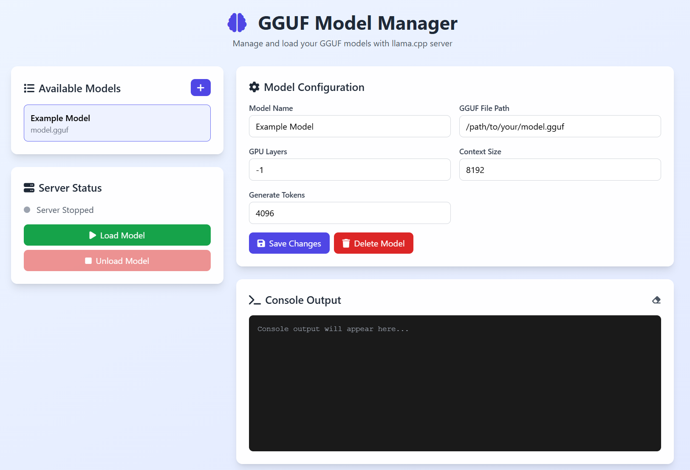

# llama-server-manager

### A web-based GUI for managing and loading GGUF models with [llama.cpp](https://github.com/ggerganov/llama.cpp)'s built-in `llama-server`.


## Features

- **Model Management** — Add, edit, and delete GGUF model configurations via a clean web interface
- **Real-time Console** — Stream `llama-server` debug output live using WebSocket
- **GPU Configuration** — Customize GPU offloading layers, context size, generation tokens and custom flags per model
- **Server Control** — Load and unload models with a single click, with live status indicator
- **Persistent Config** — Model configurations are saved to `config.json`
- **Copy config** — Hover over model profile in UI and select the `copy` icon
- **Advanced settings** — Configure custom flags and llama-server paths per model in `Advanced settings` and globally in `Settings`
- **Custom Scripts** — Launch vLLM, SGLang or any other server from your own script or commands, optionally inside a conda env or venv (see below)


## Prerequisites

- Python 3.8+
- [llama.cpp](https://github.com/ggerganov/llama.cpp) built with `llama-server` binary

## Installation

1. Install the Python dependencies:

```bash
pip install flask flask-socketio
```

2. Make sure the `llama-server` binary is available. By default the app expects it at LLAMA_SERVER_PATH:

```
<user_home_path>/llama.cpp/build/bin/llama-server
```

## Running

```bash
python app.py
```

The web UI will be available at `http://localhost:5000`.

## Run as a service (systemd)

To run the manager in the background as a **systemd user service** (no sudo, survives
logout, restarts on failure, and starts at boot via lingering):

```bash
./install-service.sh --venv          # create a project-local .venv and install deps
./install-service.sh --conda <env>   # use an existing conda environment
./install-service.sh --system        # use the system Python (python3 or python)
./install-service.sh                 # no flag: choose interactively
```

Useful commands once installed:

```bash
systemctl --user status llama-server-manager
journalctl --user -u llama-server-manager -f
```

To remove it:

```bash
./uninstall-service.sh           # stop and remove the service
./uninstall-service.sh --purge   # also delete the project-local .venv
```

The service serves the web UI on `http://localhost:5000`.

## Usage

1. Open the web UI in your browser
2. Click **"+"** to add a new model — provide the path to a `.gguf` file and configure GPU layers, context size, and max tokens
3. Select a model from the list on the left panel
4. Click **"Load Model"** to start `llama-server` with that configuration
5. The console panel streams real-time output from the server
6. Click **"Unload Model"** to stop the server

### Custom Scripts

The **Custom Scripts** tab (`/scripts`) runs any model server, not just `llama-server`. Each script profile has:

- **Script path** (optional): available to your commands as `$SCRIPT`. The working directory defaults to its folder.
- **Script contents** (optional): paste a single-file script and it's saved to the script path (made executable) when you save the profile. Leave it empty to use the file already on disk.
- **Environment**: None, a conda env (name or prefix) or a venv folder. It's activated before your commands run, and conda is found even when the manager runs as a service without conda on its `PATH`.
- **Run commands**: run with `bash`, e.g. `vllm serve Qwen/Qwen3-8B --port 8000` or `python "$SCRIPT" --port 8000`.
- **Ready pattern** (optional): the status turns *Ready* when this text appears in the output (vLLM and SGLang print `Application startup complete`).

Several scripts can run at once, independently of `llama-server`. **Stop** terminates the script's whole process group, so worker processes don't linger.

### Restarts

By default, stopping or killing the manager also stops the loaded model (`llama-server`), the RPC worker and custom scripts. That covers Ctrl+C, `systemctl --user stop`/`restart` and crashes, including `kill -9`. A small helper process (`app.py --reaper`) does the stopping, because the manager itself can't once it's been killed. Reloads after `app.py` changes never stop them.

To keep them running across manager restarts and crashes instead, turn off **Settings → When the Manager Stops**. Each process runs in its own `systemd-run --user --scope` (`llama-server-manager-<id>.scope`) when one is available, so restarting the service doesn't kill it. On startup the manager re-adopts them, including any that finished loading or exited while it was down. Open pages reconnect and refresh by themselves. In this mode, stopping the service doesn't free the GPU: use **Unload** / **Stop** in the UI. `./uninstall-service.sh` stops everything in either mode.

Output is kept in `script_runs/<id>.log` next to `app.py`, and run state in `script_runs/servers.json` and `script_runs/runs.json`.

## API Endpoints

| Method | Endpoint       | Description               |
|--------|----------------|---------------------------|
| GET    | `/api/models`  | List all configured models |
| POST   | `/api/models`  | Add a new model           |
| PUT    | `/api/models/<name>` | Update a model config |
| DELETE | `/api/models/<name>` | Remove a model      |
| POST   | `/api/load`    | Load a model into server  |
| POST   | `/api/unload`  | Unload the running model  |
| GET    | `/api/status`  | Check if server is running |
| GET    | `/api/log`     | Last 1000 output lines of `llama-server` (current or last run) |
| GET    | `/api/rpc/log` | Last output lines of the RPC worker and `llama-server`, oldest run first |
| GET    | `/api/scripts` | List custom script profiles (with script file contents) |
| POST   | `/api/scripts` | Add a script profile      |
| PUT    | `/api/scripts/<name>` | Update a script profile |
| DELETE | `/api/scripts/<name>` | Remove a script profile (the file on disk is kept) |
| POST   | `/api/scripts/<name>/start` | Start a script |
| POST   | `/api/scripts/<name>/stop`  | Stop a script and its child processes |
| GET    | `/api/scripts/<name>/log`   | Last 1000 output lines of a script |
| GET    | `/api/scripts/status` | State of every started script |

## Configuration

Models are stored in `config.json` with the following structure:

```json
{
  "models": [
    {
      "model_name": "Example Model",
      "path_to_gguf_file": "/path/to/your/model.gguf",
      "n_gpu_layers": -1,
      "n_ctx": 8192,
      "n_generate_tokens": 4096,
      "mmproj_path": "",
      "custom_flags": "",
      "llama_server_path": ""
    }
  ],
  "settings": {
    "llama_server_path": "<user_home_path>/llama.cpp/build/bin/llama-server",
    "llama_server_host": "0.0.0.0",
    "llama_server_port": 5001,
    "defaults": {
      "n_gpu_layers": -1,
      "n_ctx": 8192,
      "n_generate_tokens": 4096,
      "mmproj_path": "",
      "custom_flags": ""
    }
  },
  "custom_scripts": [
    {
      "name": "vLLM Qwen3-8B",
      "script_path": "",
      "env_type": "conda",
      "env": "vllm",
      "commands": "vllm serve Qwen/Qwen3-8B --port 8000",
      "workdir": "",
      "ready_pattern": "Application startup complete"
    }
  ]
}
```

`env_type` is `none`, `conda` or `venv`. Script contents aren't stored in `config.json`; the file at `script_path` is the source of truth.

- `n_gpu_layers`: Number of layers to offload to GPU (`-1` = let llama-server automatically calculate & decide - usually recommended) 
- `n_ctx`: Context window size (`0` = full context, decided by model)
- `n_generate_tokens`: Maximum tokens to generate per request (`-1` = full context, decided by model)

## License

MIT License — see [LICENSE](LICENSE)
